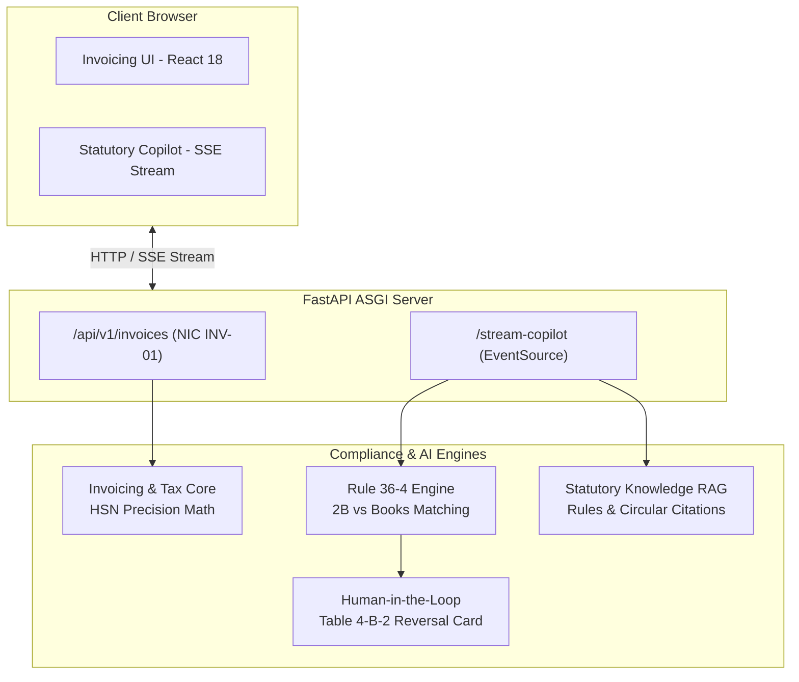

# ApexTax Enterprise | Autonomous GST & Statutory Audit Engine

Autonomous GST compliance, statutory reconciliations, and real-time AI Copilot engine built with FastAPI, Clean/Hexagonal Architecture, and Server-Sent Events (SSE).

**Live Production Deployment:** [https://gst-enterprise-engine-1.onrender.com](https://gst-enterprise-engine-1.onrender.com)  
**Live Statutory Copilot:** [https://gst-enterprise-engine-1.onrender.com/copilot](https://gst-enterprise-engine-1.onrender.com/copilot)

---

## Architecture Overview

## Core Capabilities

1. **Autonomous GST Invoicing**: NIC INV-01 compliant payload generation with automated interstate/intrastate classification and financial rounding precision (`NUMERIC(15,2)` / `round_paisa`).
2. **AI Statutory Copilot (`/copilot`)**:
   - Real-time token streaming via `sse-starlette`.
   - Dynamic tool execution status pills (`calculate_itc_rule36_4`).
   - Statutory grounding against CGST Rule 36(4), Section 16(2)(aa), and CBIC Circular No. 170/02/2022-GST.
   - Interactive Human-in-the-Loop (HITL) reversal cards to post adjustments to GSTR-3B Table 4(B)(2).
3. **Statutory Notice Defenses**: Automated response drafting for Form GST DRC-01C (Rule 88D inward discrepancies) and Form GST DRC-01B (Rule 88C outward turnover deltas).
4. **Client-Side Banking & SFT Audit**: High-speed, in-memory parser for bank statement exports auditing Section 269ST single-day cash receipt limits, Section 194N TDS thresholds, and Rule 114E SFT reporting.

## Local Setup

```powershell
# Activate local environment
.\.venv\Scripts\Activate.ps1

# Start the local development server
uvicorn app.main:app --reload --port 8000